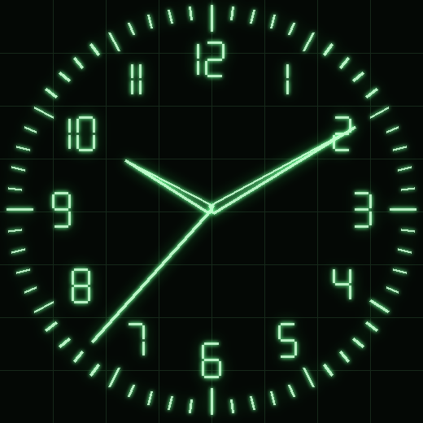
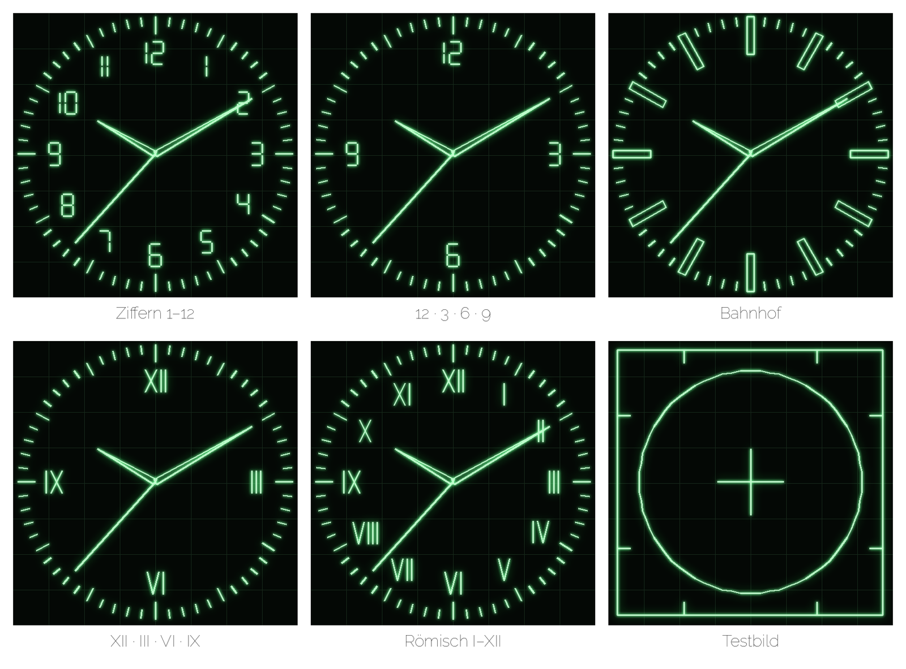
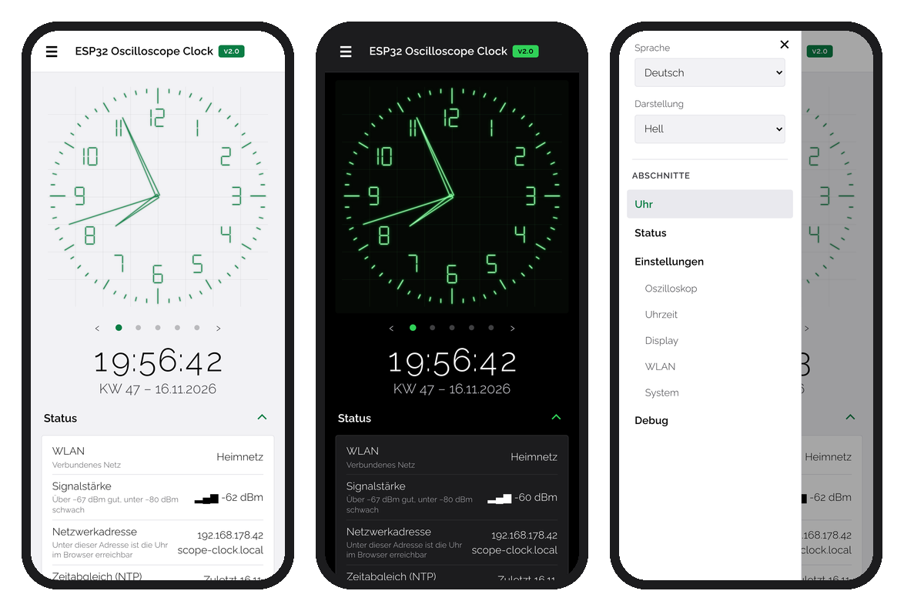
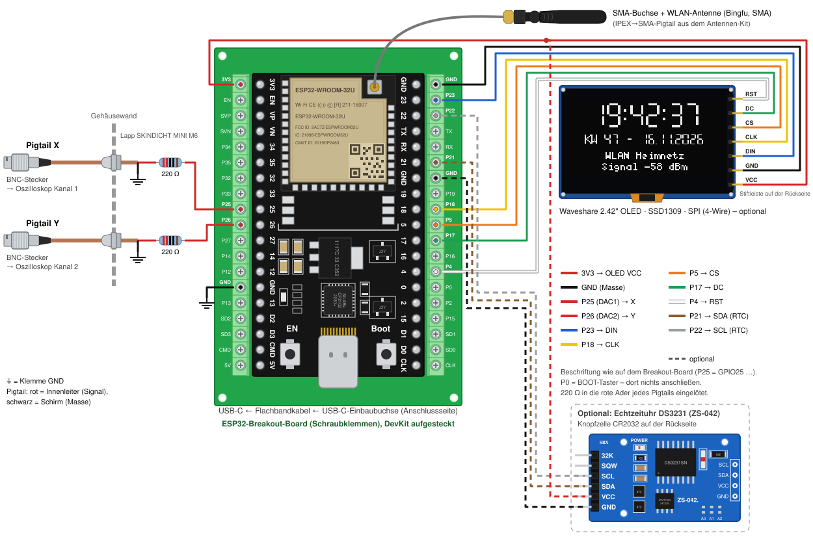
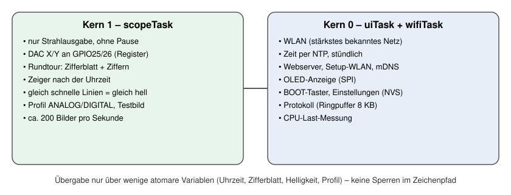

# ESP32 Oscilloscope Clock – v2.0 (Dual-Core, NTP, OLED)

**Deutsch** · [English](README.en.md)

Vektoruhr für das Oszilloskop im X/Y-Modus, nach einer Idee von Mauro Pintus (siehe [Herkunft](#herkunft)), für folgende
Hardware angepasst: **[ESP32-WROOM-32U DevKitC V4](https://www.amazon.de/dp/B0F65G3V81)**, **[Waveshare 2.42" OLED](https://www.amazon.de/dp/B0CL6WMHJN) (SPI, optional)**, externe
[2,4-GHz-Antenne](https://www.amazon.de/dp/B086JCJMSN), [BNC-Ausgänge](https://de.aliexpress.com/item/1005006318978533.html) und ein [ABS-Gehäuse](https://www.amazon.de/dp/B0B5RGNNXV). Alle Teile mit Links: [HARDWARE.md](HARDWARE.md).

**Ausführliche Dokumentation mit Aufbauanleitung, Bildern und Bohrplan: [docs/ESP32_Oscilloscope_Clock_Dokumentation.pdf](docs/ESP32_Oscilloscope_Clock_Dokumentation.pdf) (English: [docs/ESP32_Oscilloscope_Clock_Documentation.pdf](docs/ESP32_Oscilloscope_Clock_Documentation.pdf))**

**Aufbau und Verdrahtung: [HARDWARE.md](HARDWARE.md)** · **Aufbau der Software: [SOFTWARE.md](SOFTWARE.md)**

**Testseite des Webinterfaces ohne Uhr: [https://holzholz123.github.io/ESP32_OscilloscopeClock/demo/](https://holzholz123.github.io/ESP32_OscilloscopeClock/demo/)** – läuft direkt im Browser, alle Werte sind simuliert (Datei: [docs/demo/index.html](docs/demo/index.html)). Projektseite: [https://holzholz123.github.io/ESP32_OscilloscopeClock/](https://holzholz123.github.io/ESP32_OscilloscopeClock/)

### Inhalt
- [Bilder](#bilder)
- [Was ist neu](#was-ist-neu)
- [Schnellstart (Arduino IDE 2.x)](#schnellstart-arduino-ide-2x)
- [Bedienung](#bedienung)
- [Stand und Tests](#stand-und-tests)
- [Herkunft](#herkunft)

### Bilder

Die Bilder von Oszilloskop und OLED sind am PC aus den echten Firmware-Daten erzeugt, die Webinterface-Bilder
sind Screenshots der Seite. Fotos des fertigen Geräts folgen nach dem Bau des Prototyps.

**Die fünf Zifferblätter und das Testbild** – Wechsel per Wischen über die Vorschau im Webinterface

**Webinterface auf dem Handy** – Startansicht hell und dunkel, Seitenmenü

**Verdrahtung** – alle Leitungen gehen in die Schraubklemmen des Breakout-Boards, die Echtzeituhr ist optional

**Aufteilung der Firmware auf die beiden Kerne**

### Was ist neu
- **Core 1** erzeugt ausschließlich die X/Y-Signale (GPIO25/26) – ohne Pausen, ohne Locks.
- **Core 0** übernimmt WLAN, NTP und das OLED. WLAN und der Display-Bus werden dort initialisiert, damit ihre
  Interrupts den Zeichenpfad nicht stören.
- NTP über das eingebaute SNTP des ESP32. Die `NTPtimeESP`-Bibliothek entfällt.
  Zeitzone mit automatischer Sommer-/Winterzeit, stündliches Nachsynchronisieren.
- Neue Zeichenroutine mit konstanter Strahlgeschwindigkeit: Alle Linien und Zeiger sind gleich hell, auch schräge. Die Geschwindigkeit ist für ältere Röhrenoszilloskope ausgelegt (ca. 230 Bilder/s, einstellbar).
- Kaum sichtbare Rücklaufspuren: optimierte Zeichenreihenfolge, schnelle gebremste Sprünge, Sekundenzeiger als Hin- und Rückweg.
- Optionales OLED (im Prototyp verbaut; die Uhr läuft auch ohne) als reine Textanzeige: Uhrzeit (24h) im 7-Segment-Stil, Kalenderwoche und Datum mit kleinen 7-Segment-Ziffern, Netzwerkname und Signalstärke (dBm), alles horizontal und vertikal zentriert, mit Pixel-Shift gegen Einbrennen.
- Jede NTP-Synchronisierung wird mit Datum und Uhrzeit auf der seriellen Konsole (115200 Baud) gemeldet, ebenso eine Warnung, falls sie ausbleibt.
- Ohne Internet läuft die Uhr trotzdem: Die Uhrzeit lässt sich im Webinterface von Hand stellen
  (oder mit einem Fingertipp vom Handy übernehmen), wahlweise mit fester Sommer- oder Winterzeit.
  Ohne Zeitquelle zählt sie ab einer festen Startzeit hoch.
- **Optional [Echtzeituhr DS3231](https://www.amazon.de/dp/B01H5NAFUY)** (I²C, GPIO21/22): hält Datum und Uhrzeit mit Knopfzelle auch nach einem
  Stromausfall ohne Internet. Im Webinterface einschaltbar, ab Werk aus.
- Mehrere WLANs: Die Uhr verbindet sich automatisch mit dem stärksten bekannten Netz.
- **12- oder 24-Stunden-Format** für OLED und Webinterface (12 h mit AM/PM), umschaltbar im Webinterface.
- **Sprache Deutsch oder Englisch** für Webinterface, OLED-Anzeige und Protokoll, umschaltbar im
  Webinterface (Seitenmenü) und gespeichert. Startwert `UI_LANG` in `config.h`.
- **Webinterface** unter `http://scope-clock.local`, für Handys optimiert und ohne Passwort, auch als App auf den
  Startbildschirm. Darstellung hell/dunkel/automatisch, Protokoll mit Filter (Auswahlliste), Zurücksetzen mit „Rückgängig“.
  Oben zeigt es eine Live-Vorschau des Oszilloskop-Bildes (im hellen Design ohne Hintergrund),
  darunter den Status (Zeitabgleich, WLAN, Signalstärke, Profil, Bildrate, Laufzeit, Arbeitsspeicher,
  Prozessorlast, Grund des letzten Neustarts) und das Protokoll. Außerdem dient es zum Eintragen von
  WLANs. Ein einklappbares Seitenmenü (☰) springt in die Abschnitte und markiert den aktuellen Abschnitt grün, ein schmaler Balken oben zeigt die Scrollposition. **Wischen über die Vorschau
  (nach links oder rechts) wechselt das Zifferblatt**: 1–12, nur 12/3/6/9, nur Striche (ohne Zahlen), römisch XII/III/VI/IX oder römisch I–XII. Das gilt auch am Oszilloskop und bleibt
  gespeichert. Unter **Einstellungen** lassen sich Oszilloskop-Profil, Zifferblatt,
  Verweilzeit des Strahls, Helligkeit von Zeigern, Minutenstrichen und Ziffern, Rücklauf-Tempo, Zeitzone, Zeitserver (NTP) und OLED
  (Helligkeit 0–100 %, Sekunden, Pixelverschiebung, Drehung um 180°) online ändern. Dazu kommen ein **Testbild** zum Einstellen des Oszilloskops, der **Gerätename** und **Einstellungen sichern/laden** (als Datei). Die Änderungen wirken sofort und bleiben gespeichert. Das Webinterface ist immer
  erreichbar, sobald die Uhr im WLAN ist. Ohne bekanntes WLAN öffnet die Uhr das Setup-WLAN
  **„ScopeClock-Setup“**, das Handy zeigt dann automatisch die Einrichtungsseite.
- Eine Firmware für alle Oszilloskope: Das Profil DIGITAL (ab Werk) bzw. ANALOG wird im Betrieb
  per BOOT-Taster umgeschaltet und bleibt gespeichert. Getestet werden soll an Tektronix TDS3012,
  HP 54200A und Digilent Analog Discovery 2.

### Schnellstart (Arduino IDE 2.x)
1. Boardverwalter: **esp32 by Espressif** (2.0.x oder 3.x) installieren, Board **ESP32 Dev Module**.
   Unter **Werkzeuge → Partition Scheme** „**Huge APP (3MB No OTA/1MB SPIFFS)**“ wählen. Dann stehen
   3 MB statt 1,25 MB für das Programm zur Verfügung (Belegung 39 % statt 93 %). Die Uhr nutzt weder
   OTA-Updates noch SPIFFS, und gespeicherte WLANs und Einstellungen bleiben beim Umstellen erhalten.
2. Bibliotheksverwalter: **U8g2** (by oliver) installieren.
3. `ESP32_OscilloscopeClock_v2.0.ino` öffnen und hochladen. Seriellen Monitor auf 115200 Baud stellen.
4. WLAN eintragen: Mit dem Handy das WLAN **„ScopeClock-Setup“** wählen. Die Einrichtungsseite
   öffnet sich automatisch, sonst `http://192.168.4.1` aufrufen. Dort unter Einstellungen → WLAN das Netz
   eintragen (bis zu 10 Netze). Zugangsdaten stehen nie im Quelltext.
   Die Uhr verbindet sich automatisch mit dem stärksten bekannten Netz in Reichweite.
5. Oszilloskop in den X/Y-Modus schalten, 0,5 V/Div, DC-Kopplung. Bei digitalen Oszilloskopen die Zeitbasis
   auf ca. 1 ms/Div und den Trigger auf Auto stellen (Details in HARDWARE.md).
6. **Oszilloskop-Profil per BOOT-Taster:** Ab Werk ist das Profil DIGITAL eingestellt (digitale
   Oszilloskope). Für ein analoges Röhren-Oszilloskop den BOOT-Taster im Betrieb 3 s halten, das
   OLED zeigt dabei „DIGITAL > ANALOG“ mit Countdown 3, 2, 1. Die Einstellung bleibt gespeichert,
   es ist kein neues Hochladen nötig.
   (Den Taster nicht beim Einschalten drücken, sonst startet der ESP32 im Download-Modus.)

Alternativ mit PlatformIO: `pio run -t upload` (siehe `platformio.ini`, Huge APP ist dort schon eingestellt).

Die Startwerte aller Einstellungen (Zeitzone, Pins, Zifferblatt, Verweilzeit des Strahls, Oszilloskop-Profil)
stehen in `ESP32_OscilloscopeClock_v2.0/config.h`. Im Betrieb ändert man sie bequemer im Webinterface.

### Bedienung

| Was | Wie |
|---|---|
| Webinterface öffnen | `http://scope-clock.local` oder die IP-Adresse vom OLED/Log; ohne bekanntes WLAN über das Setup-WLAN „ScopeClock-Setup“ (`http://192.168.4.1`) |
| Zifferblatt wechseln | im Webinterface über die Vorschau nach links/rechts wischen (am PC: Pfeiltasten), oder Einstellungen → Zifferblatt |
| Oszilloskop-Profil DIGITAL/ANALOG | BOOT-Taster 3 s halten, oder Einstellungen → Oszilloskop-Profil |
| Echtzeituhr DS3231 (optional) | Einstellungen → Uhrzeit → „Echtzeituhr (RTC)“ |
| Werkseinstellungen (alle Einstellungen und WLANs löschen) | BOOT-Taster 10 s halten – ab 5 s zählt das OLED 5 … 1 herunter, Loslassen bricht ab |
| Dunkeltastung über den Z-Eingang (optional, drittes Kabel an GPIO27) | Einstellungen → Oszilloskop → „Dunkeltastung (Z-Eingang)“ |
| Uhrzeit ohne Internet stellen | Einstellungen → „Uhrzeit stellen“ (erscheint nur, solange kein Zeitserver erreichbar ist); Sommer-/Winterzeit automatisch oder fest |
| 12/24-Stunden-Format | Einstellungen → „Zeitformat“ |
| Sprache Deutsch/English | Seitenmenü (☰) → „Sprache“ (Auswahlliste) |
| WLAN hinzufügen/löschen | Einstellungen → WLAN (auch direkt über das Seitenmenü) |
| Oszilloskop einstellen | Einstellungen → Oszilloskop → „Testbild“ (Rahmen, Kreis, Mittelkreuz; wird nicht gespeichert). Nach dem Einschalten erscheint es automatisch 10 s lang |
| Gerätename, Sicherung, alles zurücksetzen | Einstellungen → System |
| Protokoll leeren | Abschnitt Protokoll → „Leeren“ |
| Fehlersuche | Abschnitt Protokoll im Webinterface, oder serieller Monitor (115200 Baud) |

### Stand und Tests
**Echter Build** mit Arduino-CLI 1.6.0, Board „ESP32 Dev Module“, Standard-Partitionsschema
(1,25 MB Programm), alle Warnungen eingeschaltet. Er läuft ohne Fehler und ohne Warnungen durch:

| Board-Paket | Programmspeicher | Globale Variablen (RAM) |
|---|---|---|
| esp32 3.3.12 | 1.238.170 Byte (94 %) | 74.924 Byte (22 %) |
| esp32 2.0.17 | 866.053 Byte (66 %) | 61.048 Byte (18 %) – Stand vor Menü und Zifferblatt-Umschaltung |

Die Konfigurationsvarianten (Profil ANALOG/DIGITAL, Z-Dunkeltastung, Zifferblatt 0/1/2,
`USE_FAST_DAC 0`, EXCEL-Modus) wurden vor dem Webinterface ebenfalls ohne Warnungen gebaut.
Mit dem empfohlenen Partitionsschema **Huge APP** belegt dieselbe Firmware ca. 1.235.000 von 3.145.728 Byte
(**39 %**), mit „Minimal SPIFFS“ 62 %.

Zusätzlich auf dem PC simuliert: Strahlverlauf (Helligkeit, Rücklaufspuren, Bildrate),
OLED-Inhalt, BOOT-Taster, Kalenderwoche, Speicherzugriffe (AddressSanitizer). Die Webseite
wurde in Chromium mit iPhone-Bildschirmgröße gegen nachgebildete Schnittstellen der Uhr
getestet: ohne JavaScript-Fehler, ohne seitliches Scrollen, im hellen und im dunklen Design.
**Noch nicht auf echter Hardware getestet.** Typische Stellschrauben für den ersten Test stehen in
[HARDWARE.md](HARDWARE.md) und [SOFTWARE.md](SOFTWARE.md).

---

## Herkunft

Die Idee stammt von der **ESP32 Oscilloscope Clock von Mauro Pintus** (Milano 2018):
https://github.com/maurohh/ESP32_OscilloscopeClock – vielen Dank dafür!

Diese Version ist eigenständig neu geschrieben: Firmware, Webinterface und alle Vektorgrafiken
(Zifferblatt, Ziffern, Zeiger – erzeugt mit `tools/gen_vectors.py`). Dateien des Originals sind
nicht mehr enthalten.

Die Schrift des Webinterfaces ist eine verkleinerte Fassung von **Raleway** (Copyright 2010 The
Raleway Project Authors, SIL Open Font License 1.1 – Lizenztext in [fonts/OFL.txt](fonts/OFL.txt)).
Weil die OFL für veränderte Fassungen einen eigenen Namen verlangt, heißt sie hier „ScopeClock Sans“.
